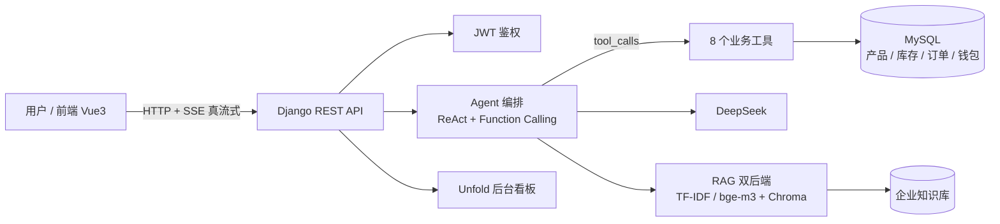

# 中渔天下 AI Agent

> 基于 Django + Vue + DeepSeek + MySQL 的企业智能客服 Demo，具备 **Agent Function Calling 工具调用、RAG 检索增强问答、真·流式输出、对话持久化、后台管理** 等能力。


**最快跑起来**（不用装 Python 环境，直接拉现成镜像，约 1 分钟）：

```powershell
git clone https://github.com/tykkkkkkan/ZT-agent.git && cd ZT-agent
cp .env.example .env    # 默认配置零 Key 即可启动；填 DEEPSEEK_API_KEY 后 AI 对话可用
docker compose -f docker-compose.hub.yml up -d    # → http://localhost:8001/
```

## 系统架构



---

## 技术栈

| 层级 | 技术 | 说明 |
|------|------|------|
| 前端 | Vue 3 (CDN) + Tailwind CSS (Play CDN) + axios | 多页面静态站 + AI 客服聊天；**不引入 npm 与构建链**，Vue 与 Tailwind 均使用 CDN 全局版 |
| 后端 | Django 5.2 + Django原生视图 | RESTful API，SSE 真流式输出 |
| AI | DeepSeek API (deepseek-chat) | Function Calling 工具调用 + RAG 检索增强 |
| RAG | 自研可插拔引擎，三档后端可选 | 切块 → 向量化 → 召回 → 重排；`RAG_BACKEND` 取 `tfidf`（默认，零依赖）/ `embedding`（BAAI/bge-m3 + Chroma）/ `hybrid`（字面路与语义路并行召回 + RRF 融合，语义路故障自动降级） |
| 数据库 | MySQL 8.0 + PyMySQL | 产品/库存/订单/对话/留言/钱包流水 |
| 后台 | Django Admin + Unfold 主题 | 状态可视化、批量动作、知识库在线维护、钱包记账 |
| 认证 | djangorestframework-simplejwt | 注册/登录/JWT（access+refresh 旋转+黑名单）/当前用户 |
| 接口文档 | drf-spectacular | Swagger UI（`/api/schema/swagger-ui/`）自动从视图生成 |
| 部署 | Docker（Django + MySQL） | `docker compose up` 一键起服务与数据库 |

---

## 功能特性

- [x] **Agent Function Calling**：基于 OpenAI 兼容 `tools` + `tool_calls` 的标准工具调用（ReAct 循环，最多 3 轮），AI 自动判断意图并调用 `query_product` / `check_inventory` / `get_order_status` / `query_orders_by_phone` / `query_my_orders` / `calculate_quote` / `search_knowledge` / `guide_to_contact` 共 8 个工具
- [x] **产品名片卡片**：对话中查过商品后自动补发 `product_card` 事件，前端渲染名称 / 规格 / 图片 / 价格 / 可用库存卡片，「立即下单」深链到 `order.html?product=<id>` 并预选商品（可购性复用 `purchase_guard`，不可购时按钮置灰并说明原因）
- [x] **顾问引导式客服（不代客下单）**：AI 先帮顾客明确产品选择（查产品/库存/报价），顾客表达购买或定制意向时调用 `guide_to_contact` 引导，前端自动渲染「定制服务 / 联系我们」按钮卡片收尾，由人工承接交易
- [x] **在线下单**：消费者通过 `/order.html` 主动下单（产品下拉 + 单价联动 + 总额自动计算，填写收货地址与期望交期），后端自动生成订单号并**预占库存**；Django Admin 可按状态筛选、一键发货/取消/退货
- [x] **库存预警（后台被动可见）**：可用库存低于预警线时，**后台看板与 Admin 产品/库存列表显示「● 预警 / ● 缺货」标识**，前台由 `purchase_guard` 给出「可下单 / 暂停接单 / 无可售库存」的明确结论
  > **口径说明**：任务书五·4「缺货时会**收到系统提示**」，本项目按「后台被动可见」口径落地（看板统计 + 列表标识 + 前台可购性结论），**不做邮件/短信/站内信主动推送** —— 单机本地容器化部署形态下没有消息通道，加推送需引入额外依赖与配置，收益不成比例。答辩若被追问，按此口径回答。
- [x] **模拟支付与订单跟踪**：订单带与状态机**正交**的支付维度（`payment_status` / `paid_at`）。未支付的订单**不可发货**（服务层统一拦截）；下单页与个人中心均可一键「模拟支付」；超过时限未支付用 `manage.py cancel_unpaid_orders --apply` 批量取消并**释放预占库存**。本项目不接真实支付渠道，因此不引入任何需要企业资质的第三方依赖
  > **口径说明**：任务书表述为「支付完成后订单进入备货流程」。本实现用**正交的支付字段**而非新增「备货中」状态来表达这一步——付款后订单即解锁发货闸门（未支付则服务层拒绝发货），企业随后安排发货。这样避免了订单状态机从 6 态膨胀到 9 态以上、以及出现「已支付且已取消」这类无意义组合。
- [x] **双路混合检索**：`RAG_BACKEND=hybrid` 时 TF-IDF+BM25 字面路与 BGE-M3 语义路**并行召回**，再用 RRF（倒数排名融合）合并排序；两路分数尺度不可比，故只按排名融合
- [x] **商品评价**：对「已完成」订单打分（1–5 星）并留言，**一单一评**由数据库唯一约束兜底；商品页展示真实均分与评价条数（点开看评价列表，姓名脱敏）；后台评价管理**只读**（评分不可人工改）。AI 客服查产品时会带上真实口碑，不凭空夸
- [x] **产品搜索与筛选**：产品页支持**关键词 + 分类 + 适用鱼种**三种查找方式（任务书二·4）。关键词命中名称 / 编码 / 分类 / 鱼种 / 规格 / 描述任一；分类是**真实字段**（后台可维护，不是前端写死的映射）；鱼种按「包含」匹配（`鲫鱼、鲤鱼` 这类多值字段能拆开筛）。纯前端筛选（数据一次取全），带结果计数与「清空条件」；AI 客服的 `query_product` 用同一套检索范围（问「鲫鱼用什么」也能查到）
- [x] **身份差异化价格**：客户分「个体钓友 / 经销商」，**批发价只在接口层对经销商下发**（非经销商的响应体里根本没有 `wholesale_price` 这个键，抓包也看不到）；经销商未达起订量（10 包）仍走零售价。价格口径统一到 `agent/pricing.py` 唯一出口 —— **产品页展示价、AI 报价、下单落库价三处同源**，不再出现「AI 按批发价报价、客户按零售价结算」。订单单价是下单当时的**快照**，改身份不回溯旧单
- [x] **RAG 检索增强问答**：企业知识库问答走完整 RAG Pipeline（文档切块 → 向量化存储 → 召回 → 重排），替代原硬编码关键词匹配；检索后端支持 TF-IDF / BGE-M3 语义 / 双路融合三档
- [x] **真·流式输出**：`stream=True` 边生成边输出，非"先全量再逐字回放"，打字机体验更真实
- [x] **Prompt 版本管理**：System Prompt 独立到 `prompts/` 目录，`load_prompt(name)` 按版本加载，便于实验与调优
- [x] **对话历史持久化**：每次对话存入 MySQL `conversations` 表，支持多轮上下文
- [x] **会话记忆与恢复**：localStorage 存储 session_id，进入页面/打开弹窗时自动从后端 `/api/agent/history/<sid>/` 拉取历史，跳转、刷新均不丢消息；支持一键「新对话」
- [x] **钓鱼主题 UI**：「江畔渔火」湖青配色 + 落日橙点缀，水波背景、波浪头栏、小鱼头像、浮漂动画等定制元素，去模板化
- [x] **用户留言系统**：前端联系表单 → 后端 API → MySQL `contact_messages` → Admin 后台管理
- [x] **多页面企业官网**：首页 / 产品 / 工厂 / 定制 / 联系，5 个独立页面
- [x] **后台数据管理**：Unfold 后台分组展示产品、库存、订单、留言、对话记录（运营看板 `/admin/dashboard/`）
- [x] **关键词兜底**：AI 未按预期输出时，用规则识别意图，保证稳定性
- [x] **订单状态机 + 库存联动**：待发货 → 发货（扣库存）/ 取消（释放预占）/ 退货（库存回滚），全程事务 + 行级锁（`agent/services.py`）
- [x] **公司钱包与流水**：发货自动记「订单收入」、退货自动记「订单退款」，后台可手动充值/扣款，收支可追溯（`Wallet` / `Transaction`）
- [x] **JWT 用户认证**：注册 / 登录 / access+refresh 令牌（旋转 + 黑名单）/ 退出 / 当前用户（`agent/auth_views.py`）
- [x] **知识库在线维护**：RAG 语料从 DB 构建，后台可直接增删改，编辑后自动失效索引缓存、下次请求重建
- [x] **真实语义向量（可选）**：`RAG_BACKEND=embedding` 切到 OpenAI 兼容 Embedding（如硅基流动 BAAI/bge-m3）+ Chroma 向量库，无需改动上层代码
- [x] **双路混合检索（可选）**：`RAG_BACKEND=hybrid` 同时跑 TF-IDF+BM25 字面路与 BGE-M3 语义路，RRF 融合排序（语义路故障自动降级）
- [x] **Swagger 接口文档**：`/api/schema/swagger-ui/` 自动生成
- [x] **LlamaIndex 对照 Demo**：`scripts/demo_llamaindex.py` 用框架实现同等 RAG，印证「先手写原理再上框架」

---

## 项目结构

```
ZT-agent/
├── agent/                      # Django App
│   ├── __init__.py
│   ├── admin.py                # ★ 注册所有模型到 Admin 后台
│   ├── apps.py
│   ├── models.py               # ★ Products / Inventory / Orders / Conversations / ContactMessage
│   ├── rag.py                  # ★ RAG 引擎（切块/向量化/召回/重排，纯标准库）
│   ├── knowledge_data.py       # ★ 企业知识库语料 + 惰性构建 RAG 引擎
│   ├── llm.py                  # ★ LLM 客户端封装（chat / chat_stream）
│   ├── prompts.py              # ★ Prompt 版本管理（load_prompt）
│   ├── agent.py                # ★ ReAct Agent 循环 + 真流式（agent_stream）
│   ├── tools.py                # ★ 工具函数 + 工具 Schema（Function Calling 定义）
│   ├── services.py             # ★ 订单状态机 + 库存联动 + 钱包记账
│   ├── auth_views.py           # ★ JWT 注册/登录/刷新/退出/当前用户
│   ├── response.py             # ★ 统一响应构造器（约定 {success,message,data}，前端按 success 判定）
│   ├── embeddings/             # ★ 可插拔 Embedder（OpenaiEmbedder 语义向量）
│   ├── vectorstores/           # ★ 可插拔向量库（ChromaStore）
│   ├── urls.py                 # ★ API 路由
│   ├── views.py                # ★ 聊天(流式)/联系表单/历史/订单库存 视图
│   └── migrations/
├── config/                     # Django 配置
│   ├── __init__.py             # PyMySQL 注册 MySQLdb
│   ├── asgi.py
│   ├── settings.py             # ★ 数据库/AI/CORS/Unfold/JWT/Swagger 配置
│   ├── urls.py                 # ★ 根路由（前端托管 + Swagger + 管理看板）
│   └── wsgi.py
├── agent/                          # Django App —— 业务域 + Agent 内核
│   ├── models.py                   # ★ Products / Inventory / Orders / Conversations / ContactMessage / Wallet
│   ├── agent.py                    # ★ ReAct 循环 + Function Calling + 真流式（agent_stream）
│   ├── tools.py                    # ★ 工具实现 + 工具 Schema（Function Calling 定义）
│   ├── rag.py                      # ★ RAG 引擎（切块/召回/重排；tfidf / embedding / hybrid 三档）
│   ├── embeddings/                 # ★ 可插拔 Embedder（OpenAI 兼容端点）
│   ├── vectorstores/               # ★ 可插拔向量库（ChromaStore）
│   ├── services.py                 # ★ 订单状态机 + 库存联动 + 钱包记账
│   ├── purchase_guard.py           # ★ 可购性唯一判定（上架 × 未暂停 × 可用库存>0）
│   ├── pricing.py                  # ★ 价格唯一出口（展示价 / AI 报价 / 落库价同源）
│   ├── order_presenter.py          # ★ 订单名片与可执行动作的唯一出口
│   ├── cashier.py                  # ★ 模拟收银台（二维码 + 局域网可达性诊断）
│   ├── auth_views.py               # ★ JWT 注册/登录/刷新/退出/当前用户
│   ├── me_views.py                 # ★ 个人中心（订单/地址/钱包/评价）
│   ├── admin.py / views_admin.py   # 后台模型注册 + 自定义看板
│   ├── management/commands/        # ★ lancheck / reconcile_inventory / fix_order_owner / cancel_unpaid_orders ...
│   ├── static/admin/               # 后台主题（zy-tokens.css 为色值唯一出口）
│   └── migrations/
├── config/                         # Django 配置（settings / urls / wsgi / asgi）
├── frontend/                       # 前端（Vue3 CDN + 预编译 Tailwind，不引入 npm 构建链）
│   ├── index.html                  # 首页 + AI 客服
│   ├── products.html               # 产品中心（动态拉取产品）
│   ├── factory.html / custom.html / contact.html
│   ├── order.html                  # ★ 在线下单
│   ├── order_query.html            # ★ 订单查询（按手机号）
│   ├── profile.html                # 个人中心
│   ├── pay.html                    # ★ 模拟收银台（扫码 / 支付 / 查单）
│   ├── pay_confirm.html            # ★ 手机端确认页（扫码后落到这里）
│   ├── login.html / register.html
│   ├── app.js                      # ★ Vue3 逻辑（流式聊天 + 自增高输入框）
│   ├── auth.js                     # ★ 登录态（localStorage / sessionStorage）
│   └── assets/
│       ├── theme.css               # ★ 设计变量与组件样式
│       ├── tailwind.build.css      # ★ 预编译 Tailwind（产物；改 class 须重跑 build_tailwind.py）
│       ├── tailwind-config.js      # Tailwind 主题扩展（湖青色阶等）
│       ├── voice-input.js          # ★ 语音输入（Web Speech API）
│       ├── favicon.svg
│       └── images/                 # 站点配图（WebP）
├── scripts/                        # ★ 验收脚本 + 构建、评测、一次性工具
│   ├── verify_*.py / verify_*.js   # 契约验收（改一处跑一处）
│   ├── build_tailwind.py           # 预编译 Tailwind（改了 class 必须重跑）
│   ├── check_page_classes.py       # 查「页面用了但 CSS 里没有」的 class
│   ├── eval_rag.py                 # RAG 检索效果评测
│   ├── create_admin.py             # 一次性：建超管
│   ├── create_staff_bot.py         # 一次性：建员工级客服账号
│   ├── demo_llamaindex.py          # LlamaIndex 对照 Demo（框架 vs 手写）
│   └── backup.sh / restore.sh      # 数据库备份与恢复
├── tests/                          # 单测与冒烟
│   ├── test_rag.py                 # ★ RAG 引擎单测（纯标准库，CI 跑）
│   ├── test_chat.py                # ★ Agent 模块冒烟（CI 跑）
│   ├── test_rag_hybrid.py          # 混合检索单测（pytest）
│   └── test_agent.py               # Day2 裸调验证（历史，需 API Key）
├── docs/                           # 技术说明与 RAG 评测产物
├── prompts/                        # System Prompt 版本（load_prompt 按名加载）
├── templates/                      # Django Admin 模板覆写
├── design-system/MASTER.md         # 视觉规范
├── locale/                         # 国际化词条
├── manage.py
├── agent_db.sql                    # ★ 数据库初始化（docker-compose 挂载执行）
├── Dockerfile                      # 镜像构建（Python 3.12-slim）
├── docker-compose.yml              # 作者侧：build + image
├── docker-compose.hub.yml          # 使用者侧：直接拉镜像，无 build
├── start.bat / stop.bat            # 本机启停
├── start-demo.bat                  # ★ 双击即跑现场演示（= lancheck --serve）
├── requirements.txt                # 主依赖
├── requirements-dev.txt            # 开发依赖（pytest / ruff）
├── requirements-demo.txt           # LlamaIndex demo 依赖（体积大，单独装）
├── pyproject.toml                  # ruff / pytest 配置
├── .editorconfig
├── .env.example                    # 环境变量模板（.env 本身不入库）
├── README.md / DEPLOY.md / PRD.md / 需求分析.md
└── .github/workflows/ci.yml        # CI：compileall + tests/test_rag.py + manage.py check
```

> **运行时产物不入库**：`chroma_data/`（Chroma 持久化）、`logs/`（运行日志）、`outputs/`（文档生成产物）、
> `staticfiles/`（collectstatic 输出）、`.venv/`、`__pycache__/`、`.env`。
> 所以 **GitHub 上的树会比本地少这几项 —— 这是正常的，不是漏提交**。

---

## 界面预览

| 首页 / AI 客服 | 产品中心 | 工厂实力 |
| --- | --- | --- |
|  |  |  |

> 更多界面见 `frontend/`（首页 / 产品 / 工厂 / 定制 / 联系 共五个页面），后台看板见 `/admin/dashboard/`。

## 快速开始

### ① 环境准备

```powershell
# 创建虚拟环境
python -m venv .venv
.venv\Scripts\Activate.ps1

# 安装依赖（完整清单见 requirements.txt，含 DRF/JWT/Unfold/Swagger/chromadb）
pip install -r requirements.txt
```

### ② 数据库初始化

```powershell
# 1. 确保 MySQL 8.0 正在运行
# 2. Navicat 或命令行执行 agent_db.sql
mysql -u root -p123456 < agent_db.sql

# 3. 确认 .env 配置正确
# DEEPSEEK_API_KEY=sk-xxx
# DB_PASSWORD=123456
```

> **数据库维护说明（重要）**：本项目采用「混合 managed」模式——
> - `Products / Inventory / Orders / Conversations` 由 `agent_db.sql` 手动建表（`managed=False`），Django 只读写不建表；
> - `ContactMessage / CustomRequest / KnowledgeChunk / Wallet / Transaction` 由 Django migration 建表（`managed=True`）。
>
> 因此：修改 `models.py` 后需 `python manage.py makemigrations && python manage.py migrate`；
> 若改到 `managed=False` 的四张表，`agent_db.sql` 也需同步手动更新（migration 仅记录状态，不改 DB），
> 并在 `agent_db.sql` 与 `models.py` 中同步字段/索引，避免两者漂移。

### ③ 环境变量

复制 `.env.example` 为 `.env`，或直接编辑 `.env`：

```ini
DEEPSEEK_API_KEY=sk-your-api-key
DB_PASSWORD=123456
```

### ④ 启动服务

```powershell
# 数据库迁移（ContactMessage 等新表）
python manage.py migrate

# 启动 Django
python manage.py runserver 127.0.0.1:8000

# 浏览器访问
# 首页：http://127.0.0.1:8000/
# 后台：http://127.0.0.1:8000/admin/
```

### ⑤ 运行单测

```powershell
# 不依赖数据库 / API Key，验证 RAG 检索与排序
python tests/test_rag.py

# Agent 模块冒烟（需要 Django 可启动）
python tests/test_chat.py

# 混合检索单测（TF-IDF 桩引擎，不访问网络）
python -m pytest tests/ -q
```

### ⑥ 创建管理员（可选）

```powershell
python manage.py createsuperuser
# 用户名：admin
# 密码：admin123
```

### ⑦ Docker 容器化部署（推荐）

**方式一：用 Docker Hub 现成镜像跑（最快，不用装 Python 依赖、不用构建）**

镜像地址：`tykkkkkk/zt-agent:latest`（[Docker Hub](https://hub.docker.com/r/tykkkkkk/zt-agent)）

```powershell
git clone https://github.com/tykkkkkkan/ZT-agent.git && cd ZT-agent
cp .env.example .env          # 默认 RAG_BACKEND=tfidf，零 Key 即可跑；填 DEEPSEEK_API_KEY 后 AI 对话可用
docker compose -f docker-compose.hub.yml up -d

# 浏览器访问：http://localhost:8001/
# 健康检查：http://localhost:8001/healthz
```

**方式二：从源码构建（改代码后用这个）**

```powershell
# 复制环境变量模板并填写真实值（DB 密码、DeepSeek Key、Embedding Key 等）
cp .env.example .env
# 编辑 .env（DB 密码、DEEPSEEK_API_KEY、EMBEDDING_API_KEY、RAG_BACKEND 等）

# 一键启动 Django + MySQL + Redis（首次会自动 migrate 建表 + 启动服务）
docker compose up -d --build

# 浏览器访问：http://localhost:8001/
# 后台：http://localhost:8001/admin/
```

> 端口说明：`docker-compose.yml` 把 web 映射到宿主机 **8001**（避开本机常见的 8000 占用）、
> MySQL 映射到 **3307**（避开本机 3306）。若你的电脑这两个端口空闲，想改回 8000/3306，
> 改 compose 文件里冒号左边的数字即可。
>
> 推送自己的镜像到 Docker Hub、以及让别人用你的镜像跑，见 **[DEPLOY.md](DEPLOY.md)** 第十一、十二节。

> 注意：`docker-compose.yml` 的 `web` 服务启动命令为
> `python manage.py migrate && python manage.py runserver`，会**自动建立 simplejwt 的
> `token_blacklist` 表**（JWT 退出 / 刷新黑名单依赖它）。本地开发若手动 `migrate`，
> 也请确保执行过该步骤，否则 refresh token 旋转会报 500。

> 本地自测用 `127.0.0.1` 没问题；**要拿手机扫码演示，见下一节
> [现场演示：手机扫码支付](#现场演示手机扫码支付)**。

---

## 现场演示：手机扫码支付

演示时最常卡住的两件事是「**手机打不开收银台**」和「**二维码里的地址手机访问不到**」。
两者都不是前端代码问题，而是「服务怎么起」与「二维码里写哪个域名」的问题。
项目为此提供了一个自检命令，把「算地址 → 查配置 → 起服务 → 开隧道」并成一条。

### 一条命令

```powershell
# 手机与电脑在同一局域网（寝室 / 家里 / 手机热点）
python manage.py lancheck --serve

# 手机用 4G 也能扫（内网穿透，需要 _tools/cloudflared/cloudflared.exe）
python manage.py lancheck --serve --tunnel
```

或者直接**双击 `start-demo.bat`**（等价于第一条；`start-demo.bat --tunnel` 加隧道）。

始终只有**一个终端**：服务与隧道由同一进程持有，`Ctrl+C` 一起退出，不会留下孤儿隧道进程
继续把服务挂在公网上。

### 它做了什么

| 步骤 | 说明 |
|------|------|
| 算地址 | 问内核路由表取本机出口 IP（比人眼在 `ipconfig` 里挑网卡可靠），打印「电脑端该打开哪个地址」「手机端探针地址」「二维码里会写成什么」 |
| 查配置 | `ALLOWED_HOSTS` 是否放行该主机、端口有没有监听在通配地址上、隧道客户端在不在、是否误用了虚拟环境里的 Python |
| 起服务 | `runserver 0.0.0.0:<port>`，带 `--noreload`（演示时手滑改文件不会触发重启） |
| 开隧道 | `--tunnel` 时托管 cloudflared quick tunnel，并把隧道域名**自动写进 `PUBLIC_BASE_URL` 与 `ALLOWED_HOSTS`** |

不加 `--serve` 时它**只读**：不改库、不起服务、不动任何文件。
其它开关：`--port`（默认 8000）、`--host`（默认 `0.0.0.0`）、`--force`（端口已被占用时强行再起一个）。

### 关键约定

- **别用 `runserver 127.0.0.1:8000`**：它只接受本机连接，手机连都连不上（页面一直转圈）。
- **二维码里的地址**由 `PUBLIC_BASE_URL` 决定；未设置时取「你请求收银台时用的那个域名」，
  都没有才去猜网卡。所以现场请用自检命令打印的那个地址打开收银台，别用 `localhost`。
- **改完 `.env` 必须完全停掉服务再启动**：`load_dotenv()` 默认不覆盖已存在的环境变量，
  runserver 自动重载出来的子进程会继承旧值，改了等于没改。
- **演示时用系统 Python 启动**（`py -3.12` / `python`）：Windows 防火墙的入站放行规则是
  **按 exe 路径**匹配的，换成虚拟环境里的 python 就对不上规则 —— 本机一切正常、手机连不上。
- **`ALLOWED_HOSTS` 没放行时 Django 返回 400，而 400 的响应体是空的** →
  手机浏览器上是一张**纯白页**（既无报错页也无任何文字）。收银台会在二维码下方直接给出原因
  （`agent/cashier.py::lan_reachability`），不必从手机那一侧猜。
- 隧道域名每次启动都会变（免费版固定不了），且该地址在公网上 —— 拿到链接的人都能访问，
  演示完 `Ctrl+C` 即断。

### 常见现象对照

| 现象 | 原因与处理 |
|------|-----------|
| 手机打开一直转圈 | 服务只绑了回环地址 → 改用 `0.0.0.0` 启动（或直接用 `lancheck --serve`） |
| 手机整页纯白、无任何文字 | `ALLOWED_HOSTS` 没放行该域名 → 加上它，或演示期临时填 `*` |
| `localhost:8000` 打开的是旧进程 | 同一端口挂了两个 runserver（Windows 允许 `0.0.0.0` 与 `127.0.0.1` **同时**监听）→ `netstat -ano \| findstr :8000` 查 PID，停掉多余的那个 |
| 二维码是空的 | `qrcode` 没装在**跑服务的那只解释器**上 → 装上后无需重启（惰性导入） |

> `lancheck` 的契约验证见 `scripts/verify_lancheck.py`（61 项）。

---

## API 接口

| 方法 | 路径 | 说明 |
|------|------|------|
| POST | `/api/agent/chat/` | AI 对话（SSE 真·流式） |
| POST | `/api/agent/contact/` | 用户留言提交 |
| POST | `/api/agent/custom/` | 定制需求提交 |
| GET | `/api/agent/history/<session_id>/` | 查询对话历史 |
| GET | `/api/products/` | 产品列表（产品页 / 下单页下拉框）；含 `category`（产品分类）；**价格字段按登录身份裁剪**（未登录/个体钓友不下发 `wholesale_price`） |
| POST | `/api/orders/` | 创建订单（下单页提交） |
| POST | `/api/orders/query/` | 按手机号查询**本人**订单（**需登录**：只能查账号绑定的手机号，填他人号码返回 403 且不透露该号码是否存在订单；脱敏：不返回姓名/电话；带 order_no 时查单个） |
| POST | `/api/orders/<order_no>/pay/` | 模拟支付（需登录 + 归属校验；落 `paid_at` 与 `payment_status=已支付`，幂等） |
| POST | `/api/orders/<order_no>/review/` | 发表商品评价（需登录 + 归属校验；仅「已完成」订单可评，一单一评，评分 1–5 星） |
| GET | `/api/products/<product_id>/reviews/` | 商品评价列表（**公开**，与产品页同口径；姓名脱敏，`review_count` 为真实总数） |
| GET | `/api/orders/<order_no>/` | 查询单个订单（脱敏 + 归属校验；staff 可跨用户查；返回支付状态与可执行操作） |
| GET | `/admin/` | Django Admin 后台管理（含产品/库存/订单/留言/对话/定制） |
| GET | `/order.html` | 在线下单页面 |
| GET | `/order_query.html` | 订单查询页面 |

### 对话接口请求示例

```json
POST /api/agent/chat/
Content-Type: application/json

{
    "message": "红虫颗粒多少钱？",
    "session_id": "abc123"  // 可选，不传则自动生成
}
```

### 对话接口响应（SSE 流）

```
data: {"content": "根据"}
data: {"content": "您的问题，"}
data: {"content": "红虫颗粒"}
data: {"content": "的零售价为"}
data: {"content": "15元/包。"}
data: {"done": true, "session_id": "abc123"}
```

> 顾客表达购买 / 定制意向时，会收到 `{"type": "guide_card"}` 事件，前端据此渲染「定制服务 / 联系我们」引导卡片（AI 不代客下单，交易由人工承接）。

---

## Agent 工具设计

| 工具名 | 输入 | 输出 | 数据来源 |
|--------|------|------|----------|
| `query_product` | 产品名 / **分类** / **适用鱼种**（如"红虫颗粒"/"薯香饵"/"鲫鱼"） | 分类、规格、适用鱼种、价格（**按登录身份给：钓友只有零售价，经销商多一行批发价与起订量**）、可购状态、**真实评分与评价条数** | `products` 表 + `purchase_guard` + `reviews` + `pricing` |
| `check_inventory` | 产品名（如"螺鲤3号"） | 总库存 / 已预占 / **可用库存**、是否低于预警线 | `inventory` + `products` 表 |
| `get_order_status` | 订单号（如"DD20240801"） | 订单状态、商品、金额、**支付状态**、收货地址与期望交期、物流、售后进展 | `orders` 表 |
| `query_orders_by_phone` | 下单手机号（**须为本人账号绑定的号码，需登录**） | 该号码名下全部订单（真实总笔数 + 物流 + 售后）；未登录或填他人号码一律拒绝 | `orders` 表 + `me_helpers.my_orders_q` |
| `query_my_orders` | 无（按登录账号） | 当前登录客户自己的最近订单（含支付状态、物流与售后） | `orders` 表 + `me_helpers.my_orders_q` |
| `calculate_quote` | 商品清单（name + qty） | 单价、小计、合计 + 不可购/超量提醒（单价走 `pricing.price_for`，与下单落库价同源） | `products` 表 + `pricing` |
| `search_knowledge` | 自然语言问题 | 相关答案片段 + 来源标题 | RAG（企业知识库） |
| `guide_to_contact` | 无 | 引导文案（去定制服务 / 联系我们） | 静态 |

### 工作流程（ReAct / Function Calling）

```
用户提问 → LLM（携带 tools, tool_choice=auto）
    ├── 模型返回 tool_calls → 执行工具 → 结果以 role=tool 喂回 → 再问 LLM（循环，最多 3 轮）
    └── 模型直接生成 → 流式输出最终回答
```

**产品定位**：AI 客服 = 咨询顾问 + 引导转化，**不代客下单**。
- 顾客咨询产品 → 查产品/库存/报价，帮顾客明确产品选择
- 顾客表达购买 / 定制意向 → 调用 `guide_to_contact` 引导，前端渲染「📝 定制服务 / 💬 联系我们」按钮卡片收尾
- 前端兜底：AI 回复文本含引导词（定制服务/联系我们/提交需求/联系客服）时也自动渲染引导卡片

- 工具定义用标准 JSON Schema（`TOOL_SCHEMAS`），与 OpenAI 兼容接口一致。
- 相比早期"正则提取 JSON"的做法，Function Calling 的意图判定更稳定、更可扩展。

### 兜底机制

- 工具调用参数非法 / 执行异常 → `call_tool` 统一兜底返回错误描述，不中断主流程。
- 模型空回复时 → 退回最后一条工具结果。
- 达到最大工具轮次仍未收敛 → 返回最后工具结果并建议转人工。

---

## RAG 架构（检索增强问答）

`search_knowledge` 工具背后是 `agent/rag.py` 的轻量 RAG 引擎，完整实现四阶段：

```
文档切块(chunking) → 向量化存储(TF-IDF) → 召回(余弦Top-N) → 重排(BM25)
```

- **零第三方依赖**：纯标准库实现，中文按「字符 bigram」切分（无需 jieba）。
- **可插拔**：`Embedder` / `VectorStore` 均为接口化设计，方便替换为生产级方案。

### 如何替换为生产级方案（对齐实习 JD）

```python
# 1. 真实语义向量：替换 Embedder 为 OpenAI / DashScope text-embedding
#    embedder = APIEmbedder(model="text-embedding-3-small")  # 实现 fit/transform/cosine 接口

# 2. 真实向量库：把 InMemoryVectorStore 换成 Chroma / FAISS / Milvus
#    store = ChromaVectorStore(collection_name="zhongyu_kb")  # 实现 add/search 接口

# 3. LLM 重排：在 retrieve 后增加一轮 cross-encoder 或 LLM 打分，替换当前 BM25 重排
```

接口约定见 `agent/rag.py` 顶部注释，替换时只需实现同名方法，`RAGEngine` 上层逻辑无需改动。

---

## 后台管理

访问 `http://127.0.0.1:8000/admin/`，登录后可见：

### 业务数据
- **产品管理**：5 款产品（红虫颗粒、九一八、螺鲤3号、蓝鲫X5、速攻2号）
- **库存管理**：5 条库存记录（含预警线）
- **订单管理**：5 条测试订单（DD20240801 等）

### 客服与用户
- **用户留言**：来自联系表单的真实留言
- **对话记录**：AI 对话历史（按 session_id 分组）
- **定制需求**：来自定制表单的提交

### 认证与权限
- **用户**：Django Auth 用户管理
- **用户组**：权限分组

---

## 开发历程

| 阶段 | 内容 | 交付物 |
|------|------|--------|
| **Day 1-2** | 需求分析 + PRD + Agent Prompt 设计验证 | `需求分析.md`、`PRD.md`、`prompts/system_prompt.md` |
| **Day 3** | MySQL 建表 + Mock 数据 | `agent_db.sql` |
| **Day 4** | Django 骨架 + MySQL + DeepSeek 接入 + SimpleUI | `config/settings.py`、`.env` |
| **Day 5** | Agent App + 工具函数 + 真实数据库查询 | `agent/views.py`、`agent/tools.py`、`agent/models.py` |
| **Day 6** | Vue 企业官网 + 多页面 + 前后端联调 + Admin 注册 | `frontend/`、`agent/admin.py` |
| **Day 7** | SSE 流式输出 + 对话存库 + 留言系统 + README | 流式改造、`contact_messages` |
| **Day 8** | RAG 落地 + Function Calling + 真流式 + Prompt 版本化 | `rag.py`、`llm.py`、`agent.py`、`prompts.py`、`tests/test_rag.py` |

---

## 后续规划

- [x] RAG 完整落地（切块 + 向量化 + 召回 + 重排，纯标准库）
- [x] 向量库升级（Chroma）+ 真实 Embedding 模型（语义检索，`RAG_BACKEND=embedding` 可切换）
- [x] Docker 容器化部署（`docker compose up`）
- [x] Swagger / OpenAPI 接口文档
- [x] LlamaIndex 对照 Demo（框架版 RAG）
- [x] JWT 用户认证 + 订单状态机 + 库存联动 + 钱包记账 + 知识库后台维护
- [ ] 接入企业微信 / 小程序客服
- [ ] 对接真实 ERP / 订单系统
- [ ] 角色权限隔离（钓友 / 经销商 / 老板）
- [ ] 语音输入 / 图片识别
