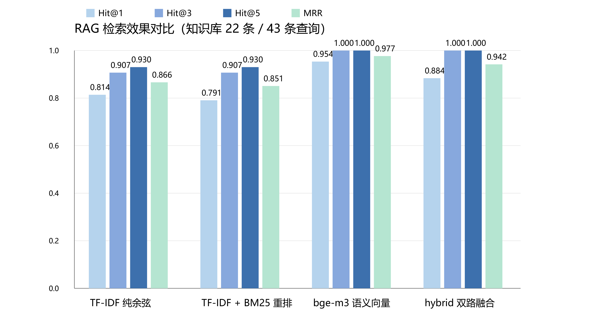

# RAG 检索效果评估

> 实验日期：2026-10-14
> 评估脚本：`scripts/eval_rag.py`　原始数据：`docs/rag_eval_results.json`　图：`docs/rag_eval_chart.png`
> 评估对象：`agent/rag.py` 的 `RAGEngine`（项目实际检索链路）

---

## 1. 实验目的

项目此前的 RAG 只有「实现」、没有「验证」——无法回答「检索到底准不准」。

本实验建立一套可复现的评测流程，给出量化指标，并回答三个问题：

1. 项目的检索链路的绝对效果如何（Hit@k / MRR）？
2. 语义向量相比 TF-IDF 稀疏向量带来多少提升？
3. BM25 重排这一步是否真的有效？

---

## 2. 实验设置

### 2.1 知识库与文档构造

| 项 | 内容 |
|---|---|
| 语料来源 | `agent/knowledge_data.py` → `KNOWLEDGE_BASE`，共 **22 条** |
| 分类构成 | 季节钓法 4 · 鱼种钓法 5 · 钓法技巧 5 · 企业政策 7 · 其他 1 |
| 文档文本 | 与 `_load_docs()` 静态分支完全一致：`标题 + 关键词 + "\n" + 答案` |
| 切块策略 | 按句边界，`max_chars=200`，`overlap=40`（`rag.py:70`） |

### 2.2 评测集

43 条真实用户口吻的查询，覆盖全部 22 条语料。其中 **5 条为刻意口语化改写**（不含原语料关键词），用于区分「字面匹配」与「语义匹配」：

| 查询 | 期望条目 | 改写特征 |
|---|---|---|
| 收到货发现不合适怎么办 | 退换货政策 | 全文无「退/换/售后/不满意」 |
| 打算订一批货，量大有没有优惠 | 批发政策 | 全文无「批发/阶梯价/拿货」 |
| 用手机付钱可以吗 | 付款方式 | 全文无「支付/转账/付款方式」 |
| 想让你们直接发给我的客户 | 加盟招商 | 意图为「一件代发」但未出现该词 |
| 什么样的位置容易上鱼 | 选钓位 | 「位置」与「钓位」不同词 |

对语义上确实存在多个合理答案的查询，用 `also` 标注**可接受答案集合**，命中任一即算正确（如「钓草鱼用什么打窝」可接受「钓草鱼」或「打窝技巧」）。

### 2.3 指标定义（文档级）

- `Hit@k`：正确条目是否出现在检索结果前 k 个**条目**中（同一语料被切成多块时按条目去重）
- `MRR`：首个正确条目排名倒数的平均值
- 为公平比较排序质量，所有实验组均**不设相似度阈值**，取回全部候选后排序

### 2.4 实验组

| 组 | Embedder | 向量库 | 重排 |
|---|---|---|---|
| A | `TfidfEmbedder`（字符 bigram 稀疏向量） | `InMemoryVectorStore` | 无（纯余弦） |
| B | `TfidfEmbedder` | `InMemoryVectorStore` | BM25 混合重排，`w=0.5` |
| C | `OpenaiEmbedder`（**BAAI/bge-m3**，1024 维） | `ChromaStore`（余弦空间） | 无（语义模式不重排） |
| D | B + C 双路并行召回 | 内存 + Chroma | **RRF 倒数排名融合**（`RAG_BACKEND=hybrid`） |

> 组 D 即 `.env` 当前运行配置（`RAG_BACKEND=hybrid`，任务书「相结合的双路方案」）。

---

## 3. 实验结果

| 实验组 | Hit@1 | Hit@3 | Hit@5 | MRR |
|---|---|---|---|---|
| A · TF-IDF 纯余弦 | 0.814 | 0.907 | 0.930 | 0.866 |
| B · TF-IDF + BM25 重排 | 0.791 | 0.907 | 0.930 | 0.851 |
| **C · bge-m3 语义向量** | **0.954** | **1.000** | **1.000** | **0.977** |
| D · hybrid 双路融合 | 0.884 | 1.000 | 1.000 | 0.942 |



### 3.1 BM25 重排权重敏感性

| 权重 w | Hit@1 | Hit@3 | Hit@5 | MRR |
|---|---|---|---|---|
| 0.00 | 0.814 | 0.907 | 0.930 | 0.866 |
| 0.25 | 0.814 | 0.907 | 0.930 | 0.862 |
| 0.50（代码默认） | 0.791 | 0.907 | 0.930 | 0.851 |
| 1.00 | 0.791 | 0.907 | 0.930 | 0.851 |
| 2.00 | 0.791 | 0.907 | 0.930 | 0.851 |

结论：**权重越小效果越好，w=0（即关闭重排）为最优**，与组 A 优于组 B 一致。

---

## 4. 结果分析

### 4.1 语义检索全面领先，且差距集中在首位命中

bge-m3 相对 TF-IDF 纯余弦：

- `Hit@1` 从 0.814 提升到 0.954（**+14.0 个百分点**）
- `MRR` 从 0.866 提升到 0.977（**+12.8%**）
- `Hit@3` / `Hit@5` 达到 **100%**，即正确条目**从未跌出前三**

对客服问答场景而言，`Hit@3` 达 100% 意味着「只要检索，答案一定在送给大模型的上下文里」——这正是 RAG 抑制幻觉的前提条件。该结论可作为论文中「选择语义向量作为默认后端」的直接依据。

### 4.2 BM25 重排在本数据集上没有增益，甚至轻微有害

组 B 的 `Hit@1`（0.791）与 `MRR`（0.851）**低于**组 A（0.814 / 0.866），权重扫描进一步确认 w=0 最优。

原因（推测，待进一步验证）：当前重排采用**线性加权** `final = cosine + BM25 × w`，两个分数量纲不一致——余弦相似度落在 `[0,1]`，而 BM25 是无上界分值（实测常达 3～10）。因此即使 `w=0.5`，BM25 项也会主导最终排序；随着 `w` 增大到 1.0/2.0，排序完全由字面匹配决定，故三档指标完全一致。

三个未命中查询中，「用手机付钱可以吗」在组 B 下被字面片段「可以」误导向「打招呼」条目，即是该现象的直接证据。

**改进方向**（可作为论文的「不足与展望」）：改为**倒数排名融合（RRF）**或先对两路分数做 min-max 归一化后再加权（已按 RRF 方向实现 hybrid 双路融合，见 §4.5）。

### 4.3 TF-IDF 的失败模式：同义改写直接返回空

组 A / B 的 3 条未命中查询，失败形态高度一致：

| 查询 | 期望 | TF-IDF 实际返回 |
|---|---|---|
| 收到货发现不合适怎么办 | 退换货政策 | **空**（无任何候选） |
| 打算订一批货，量大有没有优惠 | 批发政策 | **空**（无任何候选） |
| 用手机付钱可以吗 | 付款方式 | 误命中「打招呼」 |

前两例中，查询与语料**没有任何字符 bigram 交集**（「收到货」vs 语料中的「退换货」；「优惠」语料中不存在），余弦相似度为 0，被 `InMemoryVectorStore.search` 的 `s > 0` 过滤，**直接返回空结果**；第三例则被停用词式片段「可以」误命中，把「打招呼」顶到了首位。

这三例恰好是语义向量解决的问题——组 C 中三者全部命中。

### 4.4 附带发现：`InMemoryVectorStore` 与稠密向量不兼容（缺陷）

`InMemoryVectorStore.search()`（`rag.py:206`）调用的是 `TfidfEmbedder.cosine()`，而后者按**稀疏字典**实现（`common = set(a) & set(b)`）。

当 embedder 换成稠密向量（`list[float]`）时：

```python
from agent.rag import TfidfEmbedder, InMemoryVectorStore
a = [0.10, 0.20, 0.30, 0.40]
TfidfEmbedder.cosine(a, a)
# TypeError: list indices must be integers or slices, not float
```

即 `RAGEngine(embedder=OpenaiEmbedder())` 配默认内存向量库会**直接抛异常**；若向量取值恰好不同，则交集为空、静默返回 0.0，检索恒为空。

项目当前把语义 Embedding 与 `ChromaStore` 配对，因此该缺陷被规避，但**「Embedder / VectorStore 可插拔」的架构声明在这个组合下并不成立**。

**一行修复建议**：让 `cosine()` 按类型分派（`OpenaiEmbedder.cosine` 已经写好了稠密分支，直接复用即可），或在 `InMemoryVectorStore` 中改用 `OpenaiEmbedder.cosine`。

### 4.5 hybrid 双路融合：稳定优于字面检索，但与纯语义仍有差距

组 D（TF-IDF+BM25 × BGE-M3 并行召回 + RRF 融合，k=60，1:1 权重）：

- 相对最好字面组（A）：`Hit@1` 0.814→0.884（**+7.0 个百分点**），`MRR` 0.866→0.942（**+8.8%**），`Hit@3`/`Hit@5` 达到 100%——字面路的「同义改写返回空」三类失败全部被语义路兜住。
- 相对纯语义组 C：`Hit@1` 0.954→0.884（**−7.0 个百分点**）出现回退。原因推测：RRF 按 1:1 等权融合，字面路的错序噪声（如「可以」误导向「打招呼」）会把语义路的正确首位拉下或造成并列；在 22 条小语料上，BGE-M3 单独已足够强，字面路的边际贡献为负。
- **工程价值不在这一格指标**：hybrid 的意义是**容灾与通用性**——语义路依赖外部 API，故障时自动降级为字面路（`HybridRAGEngine` 已实现，检索失败记日志返回字面结果）；且对产品名/型号类精确查询，字面路的召回下限高于纯语义。

**论文可切入的改进方向**：给语义路加融合权重（如 `final = w·1/(k+r_sem) + (1−w)·1/(k+r_lex)`，w>0.5）、或先对语义相似度做弱阈值粗筛再融合。当前实现已通过环境变量 `RAG_RRF_K` 暴露 k 值，权重扫描可仿照 §3.1 的 BM25 扫描追加为后续实验。

---

## 5. 实验局限

1. **规模小**：知识库 22 条、查询 43 条，指标存在抽样波动，宜视为初步结论。
2. **未评估拒答**：评测集不含「知识库无答案」的查询，未考察阈值过滤（`tools.py` 中 0 / 0.2 / 1.5）的误拒与漏拒。
3. **混杂变量**：组 C 同时更换了 Embedder 与向量库（Chroma），严格来说提升不能全部归因于语义向量。
4. **未做消融**：未评估查询改写、交叉编码器重排（reranker）等增强手段；混合检索已在组 D 补上，但其 RRF 权重配比（当前 1:1）未做敏感性扫描。
5. **单一知识库**：结论目前只对「短条目、政策问答型」语料成立，未验证长文档场景。

---

## 6. 复现方式

```bash
cd ZT-agent

# 1) TF-IDF 两组 + 权重扫描（零依赖、瞬时）
python scripts/eval_rag.py --sweep

# 2) 追加语义向量组（需 EMBEDDING_API_KEY 与网络，约 40 秒）
python scripts/eval_rag.py --with-semantic --sweep

# 3) 生成论文用柱状图（需 pymupdf，用系统 Python 3.12）
python scripts/eval_rag.py --build-chart docs/rag_eval_chart.png
```

结果输出：控制台表格 + `docs/rag_eval_results.json`（含每条未命中查询的诊断信息）。

---

## 7. 论文可用素材

**可直接引用的量化结论**

1. 在 22 条企业知识库、43 条用户查询的评测集上，语义向量（bge-m3）取得 Hit@1 = 95.4%、Hit@3 = 100%、MRR = 0.977，较 TF-IDF 稀疏向量将首位命中率提升 14.0 个百分点。
2. BM25 字面重排在当前线性加权实现下无正向收益，权重 w 从 0 增大到 2.0 时 Hit@1 由 0.814 降至 0.791，表明两项分数量纲不一致导致重排失效。
3. TF-IDF 稀疏向量对不含原关键词的同义改写查询会完全失效（余弦为 0 被过滤，返回空结果），而语义向量可全部命中，验证了语义检索在口语化客服场景中的必要性。

**图表**

- 表：三组实验结果对比（见第 3 节）
- 表：BM25 权重敏感性（见第 3.1 节）
- 图：`docs/rag_eval_chart.png`（4167 × 2334 px，150 dpi）
